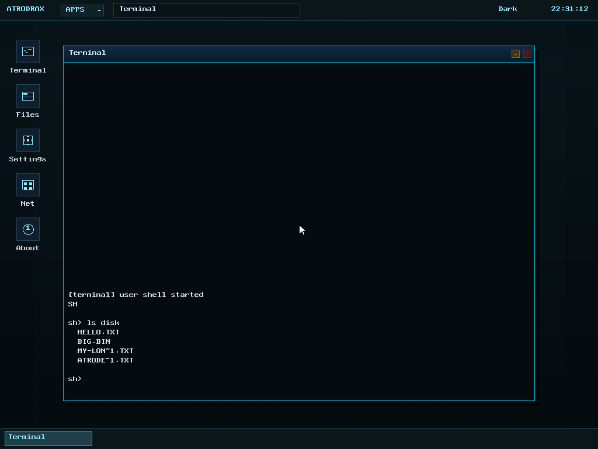
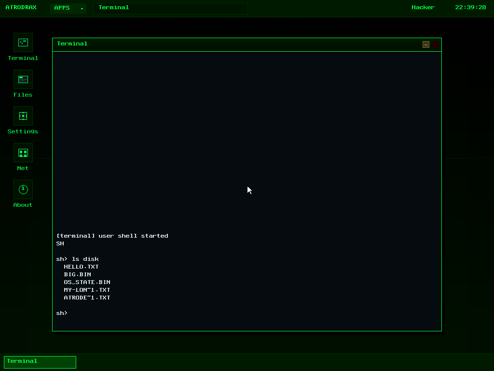

# AtrodraX-RS

**A from-scratch rewrite of the AtrodraX operating system in Rust.**

AtrodraX-RS is the Rust edition of [AtrodraX](https://github.com/ibrahimkhamiseldosoky), an
x86-64 hobby OS originally written in C. The kernel, boot path, drivers, filesystems,
network stack, syscall layer and desktop compositor have all been rewritten in
`#![no_std]` Rust; the OS still boots via GRUB/Multiboot2, enters long mode, brings up
paging, interrupts, storage and networking, and runs ELF programs in ring 3.

There is no C in the kernel, no `libc`, and no external crate. The only non-Rust
build input is the assembler source (`kernel/src/entry.S`), embedded with
`global_asm!`; everything else uses `alloc` on top of a bare-metal Rust runtime.

> **Linux ABI status: not implemented yet.**
> The loader detects Linux-ABI ELF binaries (`PT_INTERP`, low load address) and
> records the flag on the task, but the kernel does **not** yet provide the
> `syscall`/`sysret` entry point or the Linux syscall table. Native AtrodraX
> programs run today; static Linux binaries (`busybox`, `hello_linux`) and DOOM
> do not. Implementing it is the next planned milestone — see
> [Roadmap](#roadmap).



## Highlights

- **Boot**: Multiboot2 → 32-bit trampoline → long mode, GDT/TSS, 256 IDT gates,
  PIC remap, PIT at 1 kHz (100 Hz scheduling ticks).
- **Memory**: bitmap physical allocator over the first 4 GiB, 4-level paging
  with 2 MiB identity pages for the kernel and 4 KiB user mappings per process,
  64 MiB free-list heap in `.bss`.
- **Processes**: ELF64 loader, ring-3 tasks, per-task address spaces, file
  descriptor tables, `fork`/`exec`/`wait`/`kill`, round-robin scheduler.
- **Desktop**: framebuffer compositor with per-window buffers, shadows,
  titlebars, close/minimise buttons, taskbar, APPS menu, desktop icons, PSF2
  font and two live-switchable themes (Dark / Hacker).
- **Apps**: Terminal, Files, Settings, About, Network Monitor and Editor are
  kernel-side apps; 22 prebuilt userland programs live under `/bin`, including
  the shell, browser, compiler, package manager and network tools.
- **Filesystems**: RAMFS root with embedded programs, plus a FAT32 driver on
  virtio-blk mounted at `/disk` (read, write, create, delete, truncate;
  8.3 short names).
- **State persistence**: theme and desktop layout are saved to
  `/disk/os_state.bin` using the same `OSST` container format as the C kernel,
  and restored at boot.
- **Networking**: e1000 driver with ARP, IPv4, ICMP, UDP, DHCP, DNS and a
  minimal TCP stack, exposed to userspace through socket syscalls.
- **Diagnostics**: 5 boot self-tests, serial debug console (`help`), heartbeat
  watchdog, and register dumps on fatal faults.

## Building

Requirements:

- Rust nightly with the `x86_64-unknown-none` target
  (`rustup target add x86_64-unknown-none`). `rust-toolchain.toml` selects it.
- GRUB tools for the ISO: `grub-mkrescue` + `xorriso`.
- QEMU to run it (optional, `qemu-system-x86_64`).

On Linux or WSL:

```sh
./build.sh              # cargo build --release + GRUB ISO
# or
make
```

The ISO is written to `build/atrodrax.iso`, with the raw kernel staged at
`build/iso/boot/kernel.bin`.

## Running

```sh
./run_qemu.sh              # graphical QEMU window
./run_qemu.sh --headless   # no display, serial console on stdout
```

Windows PowerShell:

```powershell
.\run_qemu.ps1
.\run_qemu.ps1 -Headless
```

Both runners attach `./disk.img` as a virtio-blk disk when it exists (a 32 MiB
FAT32 image with sample files ships in the repo) and configure an e1000 NIC on
QEMU's user-mode network (`10.0.2.0/24`, gateway `10.0.2.2`).

Manual invocation:

```sh
qemu-system-x86_64 -cdrom build/atrodrax.iso -m 512M \
  -nic user,model=e1000 \
  -drive file=disk.img,format=raw,if=none,id=disk0 \
  -device virtio-blk-pci,drive=disk0,disable-legacy=off,disable-modern=on
```

All terminal output is mirrored to COM1, so `-serial file:serial.log` is handy
for headless debugging.

## Using the desktop

- Click a desktop icon or **APPS** in the top bar to launch an app.
- Drag a titlebar to move a window; the yellow button minimises, the red
  button closes.
- The taskbar at the bottom restores/focuses windows.
- **Files**: click a row to enter a directory, or use `w/s` (or arrows) and
  Enter; Backspace goes up. The FAT32 disk appears as `/disk`.
- **Settings**: click **Hacker** or **Dark**, or press `1` / `2`. The choice is
  written to `/disk/os_state.bin` and survives reboots.
- **Network monitor**: press `p` (or click the button) to ping the gateway.
- **Terminal**: type shell commands; `help` lists everything.

The terminal is backed by the ring-3 shell in `/bin/shell`. Commands include
`help`, `ls`, `cat`, `pwd`, `cd`, `mkdir`, `rm`, `sync`, `run`, `bg`, `kill`,
`echo`, `history`, `ping`, `netinfo`, `nslookup`, `udp_send`, `fetch`, `edit`,
`cc`, `make`, `fbinfo` and `exit`. Bare program names and `./name` resolve from
`/bin` as well as `/`.



## Repository layout

```
AtrodraX-RS
├── build.sh / Makefile      release build + GRUB ISO
├── run_qemu.sh/.ps1         Linux/WSL and Windows runners
├── disk.img                 32 MiB FAT32 sample disk (mounted at /disk)
├── kernel/
│   ├── src/
│   │   ├── main.rs          boot sequence and subsystem bring-up
│   │   ├── entry.S          Multiboot2 entry + long-mode trampoline
│   │   ├── boot.rs          Multiboot2 tags, memory map, framebuffer info
│   │   ├── arch/            GDT, TSS, IDT/ISRs, PIC, PIT, CPU, serial
│   │   ├── mem/             bitmap PMM, page tables, free-list heap
│   │   ├── task.rs          task table, address spaces, fd tables
│   │   ├── sched.rs         cooperative scheduling into ring 3
│   │   ├── elf.rs, exec.rs  ELF64 loader and process creation
│   │   ├── syscall.rs       int 0x80 ABI (numbers 0–41)
│   │   ├── fs/              VFS, RAMFS, FAT32, persistence
│   │   ├── drivers/         framebuffer, PS/2, RTC, PCI, e1000, virtio-blk
│   │   ├── net/             ARP/IPv4/ICMP/UDP/DHCP/DNS/TCP + sockets
│   │   ├── gfx/             font, themes, window manager, compositor, desktop
│   │   ├── apps/            terminal, files, settings, about, netmon, editor
│   │   └── diag/            self-tests, serial console, heartbeat, panic
│   └── assets/              PSF2 font + 22 prebuilt userland ELFs
├── docs/architecture.md     boot/memory/scheduler/GUI/network details
└── tools/                   headless QEMU helpers (PowerShell + Python)
```

## Syscalls (`int 0x80`)

`rax` = number, `rdi/rsi/rdx/r10` = arguments. This is the native AtrodraX ABI,
not Linux.

| # | Name | # | Name | # | Name |
|---|------|---|------|---|------|
| 0 | exit | 14 | stat | 28 | listen |
| 1 | print | 15 | dup | 29 | accept |
| 2 | getpid | 16 | pipe | 30 | sockstate |
| 3 | sleep | 17 | gui | 31 | procinfo |
| 4 | open | 18 | theme | 32 | exec_argv |
| 5 | read | 19 | net | 33 | fcntl |
| 6 | write | 20 | socket | 34 | poll |
| 7 | close | 21 | bind | 35 | sync |
| 8 | exec | 22 | connect | 36 | lseek |
| 9 | fork | 23 | send | 37 | unlink |
| 10 | wait | 24 | recv | 38 | mkdir |
| 11 | kill | 25 | sendto | 39 | chdir |
| 12 | brk | 26 | recvfrom | 40 | getcwd |
| 13 | readdir | 27 | sockclose | 41 | truncate |

## Status and roadmap

Implemented:

| Area | Status |
|------|--------|
| Multiboot2 → long mode, GDT/TSS/IDT, PIC, PIT | ✅ |
| Physical + virtual memory, 64 MiB heap | ✅ |
| Round-robin ring-3 scheduling | ✅ |
| ELF64 loader + native syscall ABI 0–41 | ✅ |
| GUI compositor, windows, themes, taskbar | ✅ |
| Kernel apps + 22 userland ELFs | ✅ |
| RAMFS + FAT32 read/write on virtio-blk | ✅ |
| Theme/layout persistence (`OSST`) | ✅ |
| e1000 + ARP/IPv4/ICMP/UDP/DHCP/DNS | ✅ |
| TCP sockets | ✅ |
| Self-tests + serial debug console | ✅ |

Not yet implemented:

| Area | Status | Notes |
|------|--------|-------|
| **Linux ABI** (`syscall`/`sysret`, Linux syscall table) | ⏳ **planned** | Loader already tags Linux ELFs; the entry point and ~173 syscall handlers are the next milestone |
| DOOM + `doom1.wad` | ⏳ blocked on Linux ABI | The game is a static Linux binary that opens `/dev/fb0` and `mmap`s the framebuffer |
| `/dev/fb0` + generic `mmap` | ⏳ planned | Prerequisite for DOOM and any direct-framebuffer app |
| Monitor protocol (PING/STAT/CRASH/EXEC over serial) | ⏳ | C kernel has it; Rust has a human debug console |
| Crash forensics ring + subsystem health scoring | ⏳ | Rust prints a register dump but keeps no records |
| Window open/close animations, icon hover fades | ⏳ | Theme timings exist; compositor currently draws instantly |
| PNG/BMP decoding + icon atlas | ⏳ | Icons are drawn procedurally |
| `deskd` userspace window manager | ➖ | Replaced by the in-kernel compositor |
| SMP | ➖ | Single CPU |
| Long FAT filenames (LFN) | ➖ | 8.3 short names, same as the C driver |

## Testing

Boot self-tests run before the desktop starts:

```
[test] PASS heap 64 KiB round trip
[test] PASS pmm alloc/free page
[test] PASS vfs create/write/read
[test] PASS fat32 root enumerable
[test] PASS network link up
[test] 5 passed, 0 failed
```

Useful manual checks inside the terminal:

```sh
help
ls                      # RAMFS root (bin, etc, home, tmp, disk, …)
ls disk                 # FAT32 root from disk.img
cat disk/hello.txt
ping 10.0.2.2
netinfo
run hello
run ps
run net
run browser             # external GUI client: creates and draws its own window
```

Headless GUI automation helpers live in `tools/`: `qtest.ps1` types shell
commands through the QEMU monitor, `qmp.ps1` injects clicks/drags through QMP,
and `ppm2png.py` / `flip.py` convert QEMU screendumps. Both PowerShell helpers
locate `qemu-system-x86_64` from `$env:QEMU` or the standard install paths and
accept `-Qemu` / `-Disk` overrides.

## Relation to the original AtrodraX

This project is a **rewrite, not a fork**: the C kernel is not linked or
vendored here. The native syscall numbers, GUI opcodes, FAT layout and the
`OSST` state-file format were kept compatible so the same prebuilt userland
ELF binaries run unchanged. The 22 programs under `/bin` are the original
AtrodraX userspace binaries.

## License

The kernel follows the original AtrodraX project's licensing. The embedded
userland binaries are the prebuilt AtrodraX ELF programs.
